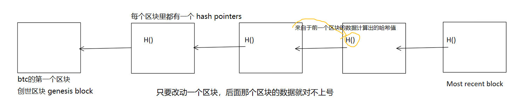

### BTC系统中用到的密码学原理

​	**crypto-currency**加密货币

​	比特币中主要用到了密码学的两个功能:哈希(cryptographic hash function)，签名

#### 	哈希

> ​	哈希函数是什么:
>
> ​		输入一个数据，他会产生一个256位二进制，目的验证数据有没有变，便于查找

​	哈希有两个重要的性质

​		**collision resistance哈希碰撞**:两个不同的输入产生了一个相同的哈希值，这种情况是不可避免的

​		**hiding**:哈希函数计算出的数据是单向的,没有办法倒推

​	digital commitment :数字承诺 = 先把一个秘密装进数字信封，公开信封；以后你可以打开证明内容，但之	前别人看不到，你也不能偷偷换内容

​		**puzzle friendly**:找答案没有捷径，只能暴力试

> 挖矿实际就找一个nonce,(nonce + 区块头的其他信息)产生一个哈希值，这个哈希值要符合一个规定的阈值
>
> 在根据puzzle friendly,你能找到nonce说明你做了大量的工作-------**proof of work(PoW 工作量证明)**
>
> ​	difficult to solve ,but easy to verify

​	BTC中用到的函数叫做SHA-256

#### 	签名

​		在去中心化的世界中，开户(账户)只需要一个(公钥public key-私钥private key)

​	        **asymmetric encryption algorithm**：非对称性加密

​			当A想要给B传送一个信息，A用B的公钥进行加密 ， B用自己的私钥进行解密

​		A 要转给 B 10 BTC ,发送到了区块链上 ，别人怎么能知道是不是A发起的呢?

​		所以需要A在发布交易的时候用A的私钥对这笔交易进行签名，

​		其他人收到这笔交易后，用A的公钥去验证这个签名

​		生成公钥-私钥需要好的随机源，签名也需要好的随机源，不然就完蛋了

### BTC中用到的数据结构

​	**哈希指针 hash pointers**

​		哈希指针与普通指针的区别，不光能指定地址还能检查出有没有数据被更改

​	区块链与普通链表的区别之一就是哈希指针

​	**哈希树Merkle tree**

​						

​	只要记住Root hash ，就能检查出整颗树更改的部位

​	每个区块用哈希指针来连接，每个区块中包含的交易组织成哈希树

​	每个区块分为两个部分 区块头 block header(有root hash)\区块体 block body(有交易列表)

​	哈希树中主要用途为Merkle proof 

​	在BTC有轻节点(block header)，全节点(block header + block body)

​		**比如我发起了一笔交易 ， 我手机上只有轻节点，我怎么知道这笔交易有没有被写到区块链上?**

​		这就涉及到Merkle proof:从这笔交易 - Root hash 就叫 Merkle proof

​		轻节点向全节点发送一个请求:能够证明这笔交易被包含在Merkle tree的Merkle proof

​					

> ​	 	总结: 轻节点向全节点发送请求进行了 Merkle proof 证明了Proof of inclusion/membership + 是否被篡改 

​	 	Proof of Inclusion 包含证明:交易属于Merkle tree

​		 Proof of membership  成员证明：交易属于这个区的集合

### BTC协议

​	**为什么要写交易来源?**：防止双花攻击(一份钱花两次)

​	**转账交易**：A的签名  +  B的地址(公钥[哈希]推算)

​	**转账的时候我是这么知道地址的?**公钥是公开的 ， 很多人通过网址公布的形式来传播

​	A ----->  B 转账  其他验证者需要验证这笔交易的合法性也需要公钥，用公钥来验证签名合法

​	**那问题来了，这么才能知道A的公钥?**输入当中还要包含A的公钥

> ​	阶段总结：BTC交易有两部分 输入 + 输出
>
> ​			    输入 = 币的来源  + A的签名  + A的公钥
> ​			    输出 = B公钥的哈希
>
> ​			    其他验证验证者需要用A的公钥来验证签名的合法性(是否为A授权)

​							

​	**full node**:全节点是保存所有信息的,验证每一个交易

​	**light node**：只保存Block header的信息

​	**如何将交易[挖出来的区块]写入区块链**?

​		**Distributed consensus**分布式共识

​		**分布式共识是什么?**多个节点对某一件事达成共识(一致的建议)

​		多个系统共同维护一个全局的hash表，需要取得共识的内容是hash表中插入了哪些键值对

​		**CAP**:  

​			Consistency 一致性: 每个节点的数据一致  

​			Availability 可用性  :  只要有需要记账的数据 ，必须响应

​			Partition Tolerance 分区容错如果单个节点无法通信，系统必须容忍这种情况，继续运作

​			只能满足C,A,P中的两个

​		**Consensus in BitCoin比特币中的共识协议**

​			BTC中共识要解决的一个问题是：有些节点是好的，还有一些节点是恶意的

​			**sybil attack女巫攻击：**如果一个区块被写入区块链不用BTC的原理，而是用每个账户/节			点投票。这样就会产生恶意节点 ， 只要账号够多 ， 那么恶意节点就有控制权了

​			在BTC换了一种形式(**PoW 工作量证明**), 每个节点都可用组装出一个候选区块，把他认为合法的交			易放到区块里，然后疯狂的算Nounce值 ，Hash(Nounce + 区块头的其他信息) <= target , 找到			后就获得了**记账权**，广播 ，其他节点收到这个这区块后要进行验证合法性

​			怎么验证呢?

​			1.检查target是不是btc协议中规定的要求

​			2.检查Hash(Nounce + 区块头的其他信息) <= target是否获得记账权

​			3.检查交易列表，验证每个交易都是合法的(1.合法的签名 ，2.有没有别花过)

​			如果有任何一个部分不合法 ，那就不能接收(上链)

​			

​			**获得了记账权的节点**,在发布的区块里有一个**Coinbase Transaction**(这笔交易不会说明币的来源)

​			BTC协议规定0-21万个区块(发行奖励50BTC)  21 - 42万(发行25BTC)...........

​						还可以获得**手续费transaction fee**， 出手续费高的交易会被优先打包进入区块

### BTC实现

​	**UTXO(Unspent Transaction Output)**：所有交易没有输出的集合

​		

​		1.UTXO中的每个元素要给出产生这个输出的交易的hash值

​		2.以及他的在这个交易里是第几个输出

​	**为什么需要这个UTXO?** 全节点要在内存中维护UTXO , 为了快速检查印花攻击

​	随着每个交易的发生，每个交易都要消耗UTXO的输出，然而每个又会产生新的交易输出 

​	total inputs = total outputs

> ​	阶段总结: 有了UTXO就有进行余额的查询，防双花等	

​	**手续费是怎么体现的呢？**输入10BTC , 输出4.99 差的0.01为手续费

​	**在挖矿的过程中 矿工需要 不断的计算Nounce  使得hash(block) <=target(Nbits) ,**

​	 **Nouce的位数是有限的，如果不足以支撑计算 ，那应该怎么办?**

​		在**Coinbase transaction**中有一个字段可用随意输入，改了这笔交易Merkle tree root就发送变化 

​	**如何验证交易的合法性?**将本笔交易的输入部分 与 币来源的那个交易的输出部分进行拼接运行(脚本)

------

​	**挖矿中的概率学问题**

​	**Bernoullai trial** : a random experiment with binary out come

​	*伯努利试验:一个只有两种可能结果的随机实验*

​	**Bernoulli process**: a seqnence of indpendent Bernouli trials

​	*伯努利过程:一系列独立同分布的伯努利试验组成的序列。*

> ​	把抛硬币看成一次伯努力试验 ， 多次抛硬币的过程就是伯努力过程
>
> ​	一次nounce计算尝试为伯努力试验 ， 多长nounce计算为伯努力过程

​	**Memoryless** 无记忆性：不管你做多少次 ， 都不会多未来的某些东西造成影响

​	**Possion process** 泊松过程: Bernouli process来近似, 一次完成的平均时间

​	**exponential distribution** 指数分布:整体BTC系统出块的时间为10min/个(系统会控制出块的时间)

​	以上内容是告诉一个区块将来要挖多长时间,与过去挖过的时间是没有联系的，

​	要符合指数分布：**progress file**

------

​	**BTC总量**

​		**geomertric serires等比数列**
$$
21w * 50 + 21w * 25 + 21w + 21w * 12.5...  = 2100w
$$
​		*Bitcoin is secured by mining 比特币是由挖矿来保障安全的*

------

​	**BTC安全性**

​	*如果有一个节点 M  ，想要转走A账户的钱 ，*

​	*他需要伪造一份交易 ， 如果硬要加入到当前区块中，*

​	*他会被识别为恶意块，其他节点会按照上个合法的块进行，按照最长合法链原则,那个恶意块会被孤立*

​	BTC的不可篡改性，取决于后面跟的区块，块越多，不可篡改性越高，指数级别增长

​	如果恶意节点获得了记账权，除了分叉攻击(上文中隐藏节点先自己挖叫:**selfish mining**)还能进行哪些?

​		不把合法的交易写到区块中:后面总有一个交易会接收这笔合法交易

​        **BTC协议规定，每个区块的大写不能超过1MB**

### BTC网络

​	用户把交易发布到网络上 ，节点收到交易后打包到区块发布到网络上，**在BTC网络中是怎么传播的呢?**

​	**application layer(应用层)**：BitCoin Block chain(比特币区块链)

​	**network layer(网络层)**: P2P Overlay Network(P2P网络覆盖)

​	想加入这个网络，需要有一个种子节点send node

​		他会告诉你网络中的其他节点，节点之间使用的TCP来通信,有利于穿透防火墙

​		离开的时候直接退出应用程序，别的节点没有该节点就会自动取消掉

​	BTC的设计的原则是简单 ， 而不是高效[**simple robust but no efficient**]

​	每个节点维护一个邻居节点的集合，消息传播在网络中采取叫flooding的方式

​		**在BTC网络系统中每个节点要维护一个等待上链的交易集合**

​		节点第一次听到某个消息的时候，把他传播到其他的所有邻居节点，

​		邻居节点的选取是随机[可能间隔很远]， 同时记录下我收到过这个消息

​		等再次收到这个消息的时候，就不用转发给他邻居节点了

​		**转发的前提的是交易合法[拥有合法的签名，以前没有被花过]**

​		**这是可能会发生交易的冲突[假设他俩花的是同一个币]**

​			*当发生了两笔交易 A ---->B  ,  A ---->C*

​			*可能会因为网络的问题 ， 假设该节点先收到了A---->B,后收到A----->C那就不管它了*

​			*如果节点听到了新产生的区块包含了这笔交易 ，那就会在集合中将其删掉*

​			*如果节点听到的是A----->C这笔交易 ， 那也要删掉，防止双花*

​	节点接收到交易，与接收到新的区块是类似的，

​		除了检查区块是否合法，还要检查是否在最长合法链上[这里就与协议--交易是如何写链上产生了呼应]

​	当一笔交易发生到btc网络上不一定每个节点都接到 ， 而且不同节点的接收交易顺序也不一样

### BTC挖矿难度

$$
H(block header)  <= target
$$

​									target值越小 ， 难度越大	

$$
difficullty =\frac{difficulty\_1\_target }{difficulty}
$$
​	**为什么要调整挖矿难度?**

​		系统中的算力越来越强 ， 出块速度越来越快 ， 分叉会出现常态

​		**51% attack  51%攻击**：恶意节点掌握了51%的算力就可以去做坏事[分叉攻击

​	**如何调整挖矿难度?**
$$
target = target x \frac{acfact\ time}{expecfed\ time}
$$
​								afact time 系统中产生2018个块所花费的时间

​								expectfed time 产生2018个块预计产生的时间

### BTC 挖矿

​	**全节点**

​					

​					     1.根据最长合法链来决定

​			                     2.根据最先监听到的来选择

​	**轻节点**

​				 	

​	BTC网络中大部分都是轻节点

​	**BTC的安全性是如何保证的?**密码学原理[签名]与共识

​	**挖矿设备**： CPU  ---->GPU ----->ASIC------>大型矿池

​	矿池[矿主 pool manager] --------->许多矿工[miner]

​		**每个矿工是如何获取收益的?**

​			每个矿工通过计算Nounce值 ， 算出来一个差不多符合target的区块(almost volid block)， 

​			上传给矿主当其中只一个矿工挖出符合Target的区块，然后根据提交的almost volid block

​			进行权益分配

​		如果矿工挖到了一个新的区块，他如果偷块自己提交怎么办?

​			不可能，区块的组装是由矿主来进行的

### 分叉

​	挖矿的时候两个节点在差不多的时间[网络延迟]都挖出来了区块，我们将这种叫做**state fork**

​	**deliberate fork**[故意的，上文中提出的分叉问题]/  **protocd  fork**[因为没有升级协议产生的分叉]

​										   	    -------hard fork

​											       -------soft fork				

​	**hard fork**: 在新的协议中产生了新的特性，没有更新新协议的节点，会不接受

​			   BTC区块大小限制[1MB] ， 每秒大概处理7个交易

​			   假设区块容量从 1M ----> 4M , 这样会导致分家个挖个的

​	**soft fork**: 在原来协议中的区块是合法的，但是在新协议中他是不合法的

​			  假设区块容量从1M - > .5M 

​			  一开始挖的是1M区块 ， 出现了分以后 ， 1M区块认可0.5M区块，但是0.5M不认1M区块

​			  这个分叉，如果新的区块成为最长合法链，那按旧的区块挖的 ， 就会默认被回滚

​			  不会有永久性的分叉

​	Coinbase transaction 中有一个  coin base[在上文中有提到他的作用:H(区块头)计算不足]

​			  coinbase中有很多字节只有8bytes共计算 ， 还有很多其他字节 ， 有人提出加入UTXO根哈希

​			  因为UTXO结合并没有存在在区块中 

​			  这样会产生一个问题 轻节点  ---->  全节点发送请求查询余额，但是你如何确保他不会篡改数据呢?

​			  	将全节点的UTXO上交易记录一样产生一个Merkcle root hash放到coinbase中  -------软分叉

​	BTC一个经典的软分叉为:P2SH

------

### BTC总结

​	有轻节点发出交易 ， 通过广播传送至其他的节点 ， 其他节点接收进行检查[UTXO , 签名，交易内容]

​	完成后放入内存池  ， 矿工开始组装候选区块+从内存池挑选交易，开始计算H(block header)<target

​	计算成功后，广播至其他节点，进行验证，上链，更新UTXO

​	[最长合法链,分支,印花等问题] 

​	[疑问:钱包与轻节点?]

------

### 以太坊ETH

​	**ETH对BTC中出现的一些问题进行了改进**

​		出块时间:BTC中的出块时间是10min/个，以太坊大幅度降低到十几秒

​		memory hard mining puzzle:大大降低了矿机的使用

​		共识机制:Pow

​		smart contract:智能合约

​	Ethereum , ETH , Ether  最小单位Wei

​	**去中心化合约**:一份写在区块链上，有代码自动执行的“自动合同”  ，并不是所有的合同都可以写成智能合约

​				**有什么好处?**

​				代码一旦发送到区块链上就没有人能进行更改，那也就是说所有人都只能按照这个规则来进行

### 账户

​	BTC中并没有显示的记录每个账户上有多少，需要根据UTXO中的信息来推算[隐私保护较好]

​		*这种模式会出现的问题:  A------B(10BTC)         B------->C(3BTC)[来源于A]*

​											     *这样的话在交易中剩下的5BTC会被当做手续费给矿工*

​											     *所有B需要在增加一笔交易B----->B'[另外一个账户]*

​	ETH中采用的是基于**账户的模型(account-based ledger**)，系统中要显示有多少ETH

​			*如果要转账，只要验证账户中是否有这些币即可*

​			**这样做有什么好处?**

​			以太坊的账户模型对double spending attack[双花攻击]有天然的保护

​			**有什么弱点?** replay attack :  A-----B转账 ， B是一个恶意节点 ， 他又将这笔交易广播了一次

​			**如何解决?**增加一个Nounce计数，和这笔交易一起被签名 ，这样的话Nouce就不容易被篡改，

​					  当交易被广播到节点后会自动+1

​	ETH中有两种账户

​			**外部账户**(externally owned account):balance[账户余额] ， nouce[计数]，

​											所有的交易只能由外部账户发起

​			**合约账户**(smart contract account):合约不是利用公私钥来控制的，合约账户不能主动发起一笔交易

​										    code , Storage[存储]

​			**如何调用合约账户呢?**

​				创建了一个合约账户，会返回一个地址，知道合约地址就可以调用合约，状态会发生变化

> ​	理解外部账户:外部账户是全节点进行维护的，类似于UTXO但比UTXO高级 
>
> ​				全节点的外部账户集合是什么样呢的 “我的地址”=>{"nouce","blance,storage,codehash"}
>
> ​				全节点维护了很多人的外部账户

​	通过智能合约衍生出了 financial derivative[金融衍生品]

### 状态树

​	一个账户地址到账户状态的映射

​	ETH中的账户地址使用的是160bits [40个16位进制数]

​	**以太坊利用什么数据结构来维护账户状态?**

​		**trie(前缀树)**:

​									

​		1.branching factor(分支数目):因为是16进制，0-f + 结束标识符[17]

​		2.tire不会出现碰撞

​		3.tire不论怎么输入，得到的结果是一样的

​		这样会有一个问题，会出现一脉单传的情况,如果能节点合并，能减少存储的开销和查找效率

​		引出了**Patricia tree** ----->对其进行压缩

​									

​			如果我插入了一个新的单词，就要拆开后在进行压缩

​		键值稀疏时使用Patricia tree比较好

​		**Merkle Partricia tree(MPT)**  ------->  **Modified MPT**	

​			根哈希有什么用 1.数据没有被篡改 2.能证明账户有多钱

> ​		   知识理解:  MPT中有roothash , 这样轻节点发送一个请求获取Merkcle proof[从最底下到经过的
>
> ​		                     各个节点单拎出来]，这样就能根据我持有的账户地址查询余额，
>
> ​				     同时能检查是否被串改

​		**每次发布新区块的时候，状态树会有一些值发生改变，这些值并不是在原有的基础上改变**

​		**他会直接指向原有的节点 +  有需要的进行扩建**

​						

​		每一合约的Storage 都是一个小的MPT

> ​		知识理解
>
> ​			假设A节点 记录了一个完整的状态树 ， 并把state root放进了#100区块中
>
> ​			其他节点同步了该节点了状态树[根据区块中的交易列表进行了同步]
>
> ​			现在产生了新的交易
>
> ​			假设还是A节点 , #100对应的状态树
>
> ​			在新建一块区域这个区域里只获取 **要改变数据的节点/新建的节点**
>
> ​			在进行state root[改动的节点 + 保留不变的节点] ，放入到#101区块中
>
> ​			**全节点记录了每个区块对应的状态树**[埋个伏笔:归档节点]			   

​		系统中全节点需要维护的不是一个MPT状态树， 而是每出现一个区块都要新建一个MPT

​		只不过这些状态树中的节点是共享的，只有少部分发生变化的节点需要新建分支

​		**为什么要保留历史状态,为啥不直接在原地替换?**

​			 在ETH中因为出块太快会出现临时性的分叉，根据最长合法链原则，要对较短的

​			 区块进行 roll back 回滚 , 回滚就要回到历史状态

​		**ETH的block header区块头**(老版)

​						

​		**状态树中保存的是(Key[地址] , value)形式**

​			将key放在状态树中需要经过序列化的过程RLP

###  交易树和收据树

​	交易树与BTC的交易列表的Merkle tree是类似的

​	收据树:每次交易后会形成一个收据记录一些信息

​		[完全是因为智能合约过于复杂，每次交易后可以看到执行后的信息]

​	交易树与收据树对应的节点是一样的 ， 都是MPT[代码统一，方便查询]

​	交易树与收据树只把当前区块的交易组装起来的

​	**交易树与收据树有什么用呢?**

​		**提供Merkle proof** ,证明区块里是否存在这笔交易/交易成功后的信息

​		**复杂查询操作**[过去十天某个合约账户产生的一些交易]

​			ETH中引入了bloom filter[数据结构:高效查询]

​							

​			bloom filter不能使用 删除

​			**如何在树中使用的?**

​				每个交易成功后会产生一个收据[包含了一个bloom filter[记录这个交易的类型,地址]]

​				在区块头中会有一个总的Bloom 是每个交易产生的bloom的并集

​			**那是如何查找过去10天哪个区块有我想要的交易类型呢?**

​				先在所有的区块头的bloom中寻找,找到对应的区块的交易所对应的bloom

​				如果有的话，我们就能直接定位到该区块的哪笔交易 

​			**为什么要这样做?**

​				方便轻节点进行查询，因为轻节点没有交易列表只有区块头

> ​	在这里要注意收据是每执行完(每次更改完状态树)产生的 ，存储在全节点，出块者需要在区块头填写
> ​	其他节点验证者需要根据交易列表执行交易更改状态树的时候产生 ， 与区块头的收据根进行对比

​	**状态机 transaction-driven state machine**

​		当旧状态树  根据交易列表的交易进行更改[在新建的区域获取需要改的节点] -----> 产生了新的状态树

​		这个过程就叫做**基于交易的状态机**

### Ghost协议 / 挖矿 

​	肖臻老师的课是2018年发布的，共识机制早已从PoW , 变成了PoS , 因此该部分我选择忽略

#### 权益证明Proof of stake(PoS)

​	在2022年ETH已经转变为PoS,为什么淘汰PoW电力消耗太大

​	采用权益证明的加密货币，一般在正式放行之前会先预留一部分货币给开发者/出售货币

​	权益证明与工作量证明不是互斥的

​	以太坊中采用的权益证明为 **Casper** the Friendly Finality Gadgset(FFG)  --------

​		他在早期也是要和PoW混用的

​	在Casper协议中引用了一个Validator验证者 ， 想成为一个验证必须投入一定数量的保证金

​		**职责**:推动系统达成共识 ， 投票决定哪条链为最长合法链，权重为保证金的大小

​		**具体做法**:  每100个区块为一个epoch[在2026年的今天 12s/slot 1epoch = 32slot]

​				  epoch需要进行投票完成最终确定[finality]

​				  two phase commit: Perpare Message[第一轮投票 2/3以上的验证者通过]

​								     Commit Message[第二轮投票]

​				  实际系统中不在区分Message,每个epoch只用一轮投票 ,

​				  这一轮投票对于上一轮是Commit Message ， 对于下一轮投票是Perpare Message

​				  连续两轮投票，每轮都要得到2/3的投票才算有效

> ​	1.想要成为验证者  需要质押32个以上的ETH 
>
> ​	    当成为活跃验证者后
> ​        2.在Pos机制下  ， 1solt 对一个区块 = 12s  , 1epoch = 32solt
> ​	    每个solt会在活跃验证者中跳出一个提议者 ， 
>
> ​	    同时组建一个 验证者委员会 负责 每1个epoch的投票任务Attestation
>
> ​        3.成为提议者的节点  ， 负责组装区块/执行交易更新状态树，
>
> ​	   广播给其他节点[包括验证者委员会的成员] ， 进行验证区块
>
> ​	4.验证成功后,验证者委员会负责对这个slot进行投票，每个验证者委员会的成员对投票进行签名，广播
>
> ​	5.根据分叉，Ghost ，Casper最终确认在 上链[**后续学习待补充**]
>
> ​	肖臻老师的课程在2018年 不符合 现在ETH运行机制

### ETH运行全流程

​	当产生了一笔交易后 ，全节点检查该交易是否合法

​	合法后进入待选池

​	然后开始Pos环节 ， 最终确认上链后，其他节点根据上链的区块执行交易更新本地状态树

​	*EL 执行客户端 ：负责接收/传播/执行交易 更新状态树产生收据树等*

​	*CL 共识客户端 :   负责接收/检查区块 共识 ， solt ，eopch ， 提议者，验证者[委员会]等*

​	*验证者客户端 : 能质押成为验证者[可以不装，就无法获得提议权]*
