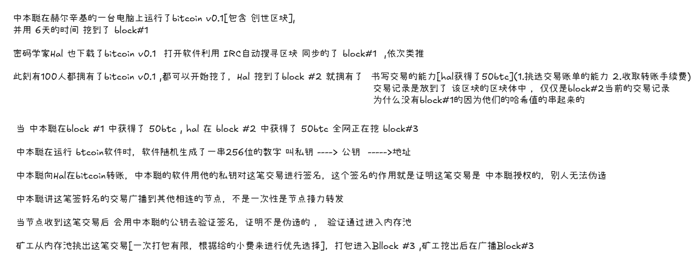
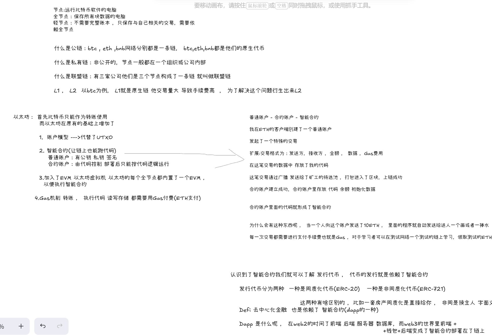

## BTC ETF底层理解

## ETH - 《021学习以太坊》

### 1.以太坊的平台定位与核心特性

#### 	平台定位

​	ETH(以太坊)是一个去中心化，开源且具备智能合约的公共区块链平台，其核心组件为以太坊虚拟机(Etherum Virtual Machine ,EVM)

​	以太坊使用名为”以太“(Ether 简称ETH)的加密货币作为内部交易的”燃料“(Gas) ,用于支付交易的费用和计算服务

#### 	核心特性

​	相对于大多数其他的加密货币或区块链技术，以太坊的特点包括但不限于以下几点:

##### 	1.智能合约

​		智能合约是存储在区块链上的程序，有网络节点执行，以太坊已从早期的”矿工(pow)“过度到了”验证者(PoS)“的时代，这些验证者负责打包并执行，任何想要执行合约的人，都要使用Gas作为手续费

##### 	2.分布式应用程序(dapp)

​		不依赖单一服务器，只要以太坊网络和客户端还活着，dapp就很难被单一主体关停

##### 	3.代币

​		同质化代币(ERC-20) 例如游戏里的”金币“ ，治理代币 ， 稳定币(UDST) 

​		非同质化代币(ERC-721 / ERC-1155):对应的独特资产，如艺术品，门票，或游戏角色

​		两种代币只是采用了不用的记账规则

##### 4.权益证明(Pos) 与 早期的工作量证明(Pow)

​		以太坊早期的机制 和btc的机制一样， 通过算力竞争出块 ，由于需要依赖高昂的硬件,电力成本

​		以太坊转换为了Pos（权益证明）

​		**Pow(工作量证明)**:1.大家把交易广播到内存池

​					      2.矿工把交易打包进区块

​					      3.矿工通过拼算力获得了记账权

​					      4.算出来后广播区块，全网节点验证通过，接到最长的链后面

​					      5.矿工获得了50BTC

​					      优势：极度安全(篡改账本需要51%的算力)

​		**以太坊为什么要抛弃Pow呢 ?**

​			 产生区块太慢，DeFi ， NFT , Dapp 跑不起来

​			太贵，手续费太贵

​			太中心化，大矿工垄断记账权

​		**PoS(权益证明)**

​			系统通过随机算法，从所有质押了32个ETH的验证者中，

​			随机挑选一个出来，在这个12s呢负责打包区块，质押越多被随机选中的概率越大

​			系统还会随机挑选一批”委员会成员“，打包出区块后，委员会成员负责投票，投票通过后

​			这个区块就被确认了，每6.4分钟进行一次大清算，一旦获得三分之二的总质押量，就达到了

​			最后的确认，这个区块就不可逆转

​			奖励与惩罚

​				打包区块的验证者获得 ETH奖励和Gas费，参与投票的委员会也会获得奖励

​				如果你质押了32个ETH ，但是节点掉线了没有产于投票，系统每天就会扣除你一点点的ETH

​				如果试图篡改账本，系统罚没你的一部分ETH,并剔除网络

##### 	5.燃料费

​		”燃料“ (Gas) 是对计算机与存储资源的计量单位，发送ETH，转账代币，调用合约，部署合约，都会消耗Gas，EIP-1559之后 Gas费由”基础费用(base fee)“ + "小费(priority fee)" 组成，其中基础费被销毁， 小费奖励给验证者

##### 	6.Proto - Danksharding(EIP -4844) 与Dencum升级

​		**EIP - 4844解决的什么问呢？**

​			之前我们提到了L2是为了解决L1拥堵和手续费贵的问题，才衍生出来的

​			现在呢又出现了新的问题L2上接收到的交易记录打包到L1区块体**CALLDATA** 中进行永久存储

​			但是硬盘空间贵， L2解决的手续费贵的问题又出现了

​			于是EIP - 4844 出现了，区块可以携带6个Blocb临时存储空间，L2将打包好的数据放到Blocb里面,

​			在L1进行公示(18天以便其他人员进行审核)，18天后消失，但是并不代表这个交易数据就没了

​			他只是临时存在，真正的数据还在L2

##### 	7.分片与Danksharding

##### 	8.叔块(Uncle / Ommer Block)